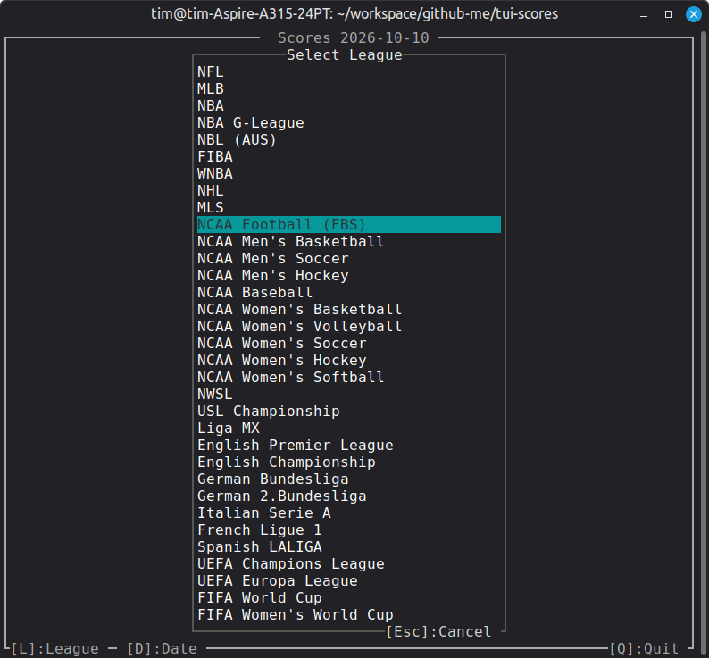
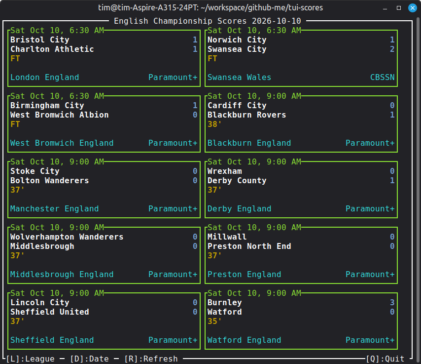
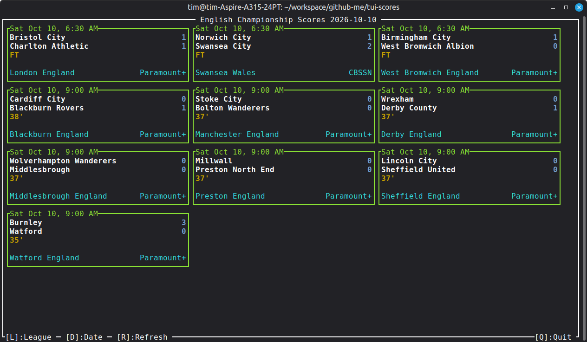
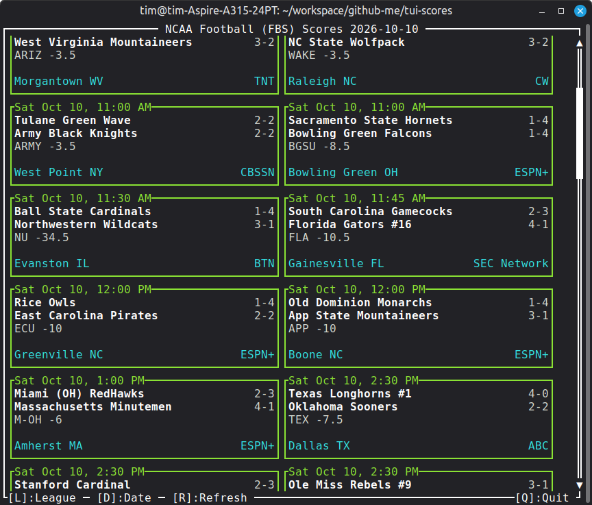
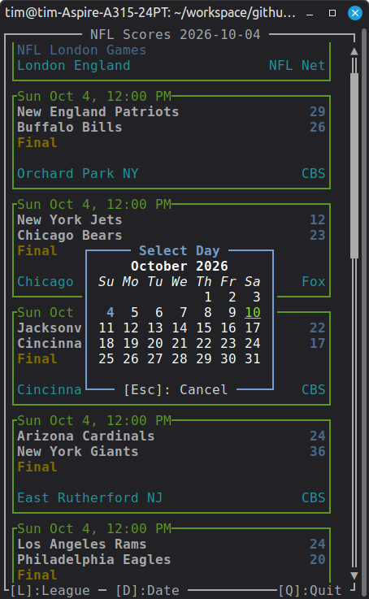

## TUI-SCORES 

Application to display sports score data in a responsive TUI (Text User Interface). 

An exercise in "kicking the tires" with Ratatui-Kit [https://yexiyue.github.io/ratatui-kit/]

### Quirks

- All sports list the home team second which is against the convention used by soccer.
- Currently lagging when displaying large amounts of events like some days of NCAA sports. This issue could be a Ratatui Kit problem. 

### Screenshots

### Future Features
- Highlight dates on the date picker where there are events for the current league. This may limited to certain
leagues that provide a dicrete list of dates and it would be for the last event season but that is better than nothing. 
